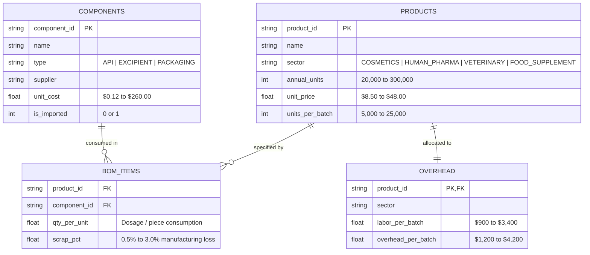
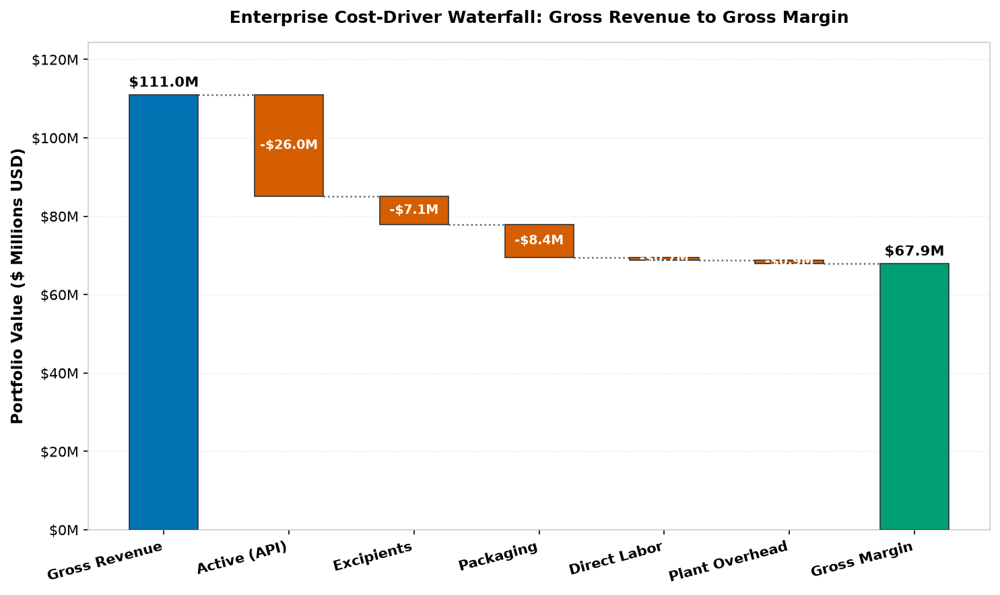
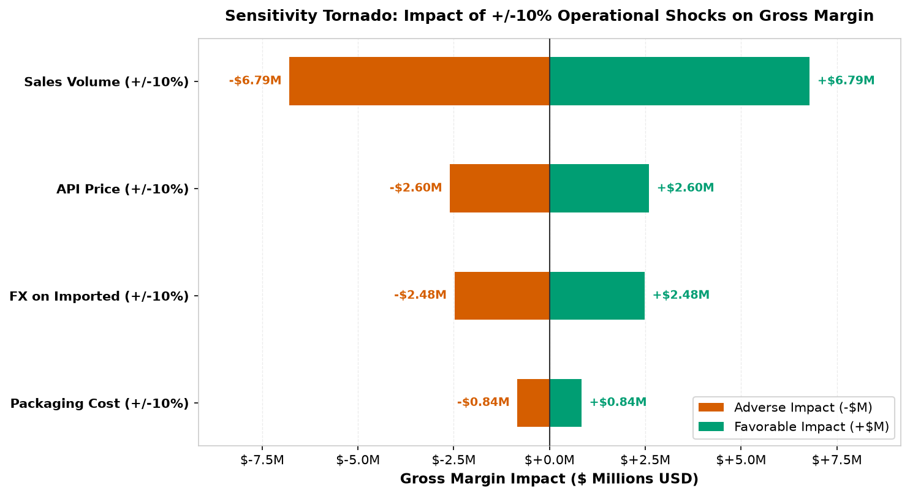
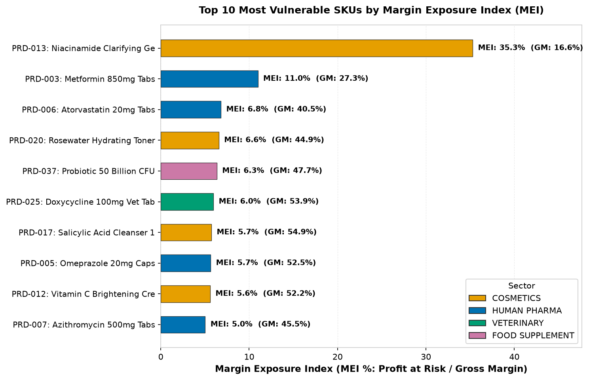
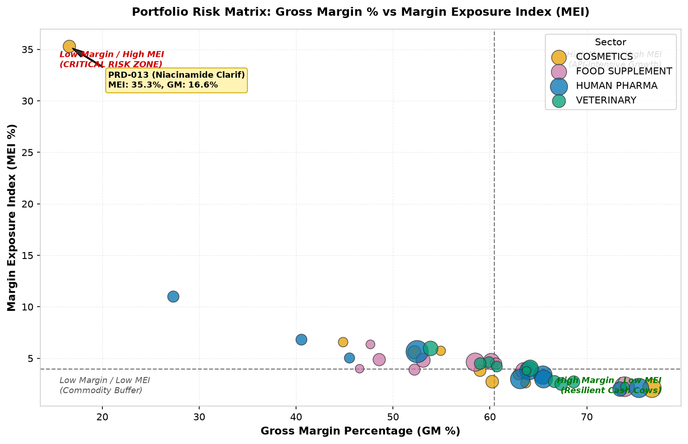

# Pharmaceutical COGS & Margin Exposure Analysis

[](LICENSE)
[](https://www.python.org/)
[](https://www.sqlite.org/)
[](#)

A decision-grade cost accounting, margin vulnerability, and commodity shock resilience framework for multi-sector pharmaceutical manufacturing, implemented in SQL (SQLite) and Python (pandas/NumPy/SciPy).

---

## Headline Finding

> **Across a $111.01M commercial portfolio (40 SKUs across 4 sectors), an isolated +10% price shock in active pharmaceutical ingredients (APIs) places $2,599,312.73 of gross margin at immediate risk. Profit vulnerability is heavily concentrated: while the portfolio-wide Margin Exposure Index (MEI) averages 3.83%, acute vulnerability peaks at 35.29% for `PRD-013` (Niacinamide Clarifying Gel), where a +10% active ingredient surge erases more than one-third of total product operating profit due to low initial margins (16.60%) and high active substance intensity (70.27%).**

---

## Business Context

In high-mix regulated manufacturing spanning **Cosmetics, Human Pharmaceuticals, Veterinary Medicine, and Food Supplements**, product margins are subject to extreme commodity price volatility. Active Pharmaceutical Ingredients (APIs), specialized botanical extracts, and imported excipients face global supply pinches, currency fluctuations, and regulatory compliance re-certifications.

When input costs escalate, executive leadership typically monitors standard gross margin percentage ($\text{Gross Margin} / \text{Revenue}$). However, conventional gross margin is a blind risk indicator:
- A high-margin formulation (e.g., 55% gross margin) with 75% API cost concentration can suffer far greater dollar and percentage margin degradation than a lower-margin formulation (e.g., 30% gross margin) whose cost base is predominantly local packaging and fixed overhead.
- Procurement and commercial finance teams lack an objective, rank-stable index to identify which products require immediate price pass-through, long-term supplier hedging, or yield reformulation.

This study implements an enterprise-grade cost roll-up engine, automated master data hygiene audit, and a novel sensitivity metric—the **Margin Exposure Index (MEI)**—to quantify and prioritize product vulnerability to raw material inflation.

*Note: All data in this repository is 100% synthetic, generated under seed=42. No proprietary company data, commercial secrets, or real supplier contract terms are present.*

---

## Data Model Architecture

The data architecture models an enterprise ERP standard costing schema across four relational tables in SQLite (`data/cogs.db`):



---

## The Analytic Decisions That Matter

1. **Automated Master Data Hygiene Audit Before Cost Roll-up:** Real enterprise costing databases inherit data corruption from ERP migrations and manual entry. Before executing financial CTEs, the pipeline audits and neutralizes 6 specific dirty-data failure modes (duplicate BOM lines, orphan BOM items, missing component costs, negative standard costs, zero batch sizes, and non-positive prices), logging full audit trails to `out/data_quality.csv`.
2. **Transparent Multi-Echelon SQL Cost Roll-up:** Rather than relying on black-box spreadsheets, all cost aggregations (direct active ingredients, excipients, primary/secondary packaging, direct labor, and batch overhead) are executed using SQL Common Table Expressions (CTEs) directly inside SQLite.
3. **Margin Exposure Index (MEI) for Actionable Prioritization:** Formulates an objective metric linking commodity price volatility directly to gross margin erosion, isolating products whose viability is precarious under inflation.
4. **Rank Stability Verification:** Validates that MEI rankings remain stable against measurement errors in active component cost share ($\pm 20\%$) and base margin assumptions ($\pm 5\text{ pp}$), proven via top-10 overlap and Spearman rank correlation ($\rho$).

---

## Prioritization Methodology: Margin Exposure Index (MEI)

### Why This Index?
Conventional cost analysis monitors either absolute dollar spend or gross margin percentage. Both measures fail under inflation:
* **Dollar Spend Bias:** Sorting by total API spend highlights high-volume blockbuster drugs, even when those drugs enjoy robust 65% margins that easily absorb input price hikes.
* **Margin Percentage Bias:** Sorting by lowest gross margin percentage highlights commoditized products, even when their cost structure is dominated by fixed packaging, leaving them completely unaffected by API shocks.

The **Margin Exposure Index (MEI)** solves this by calculating the exact proportion of product gross margin erased by a standardized +10% price increase in its active ingredient:

```text
MEI (%) = (Profit at Risk / Annual Gross Margin) × 100

Where:
  - Unit Cost = API_Cost + Excipient_Cost + Packaging_Cost + (Labor_Batch + Overhead_Batch) / Batch_Size
  - Annual COGS = Annual Units × Unit Cost
  - Annual Revenue = Annual Units × Unit Price
  - Annual Gross Margin = Annual Revenue − Annual COGS
  - API Share = API Cost per Unit / Unit Cost
  - Profit at Risk = Annual COGS × API Share × 0.10
  - Break-Even API Price = Current API Price × (1 + Gross Margin / (Annual COGS × API Share))
```

When Gross Margin $\le 0$, the product is flagged as `negative-margin` rather than dividing by zero.

### MEI Mathematical Implementation
```python
def calculate_mei_metrics(
    annual_units: int,
    unit_price: float,
    api_cost_per_unit: float,
    direct_material_cost: float,
    batch_overhead: float,
    batch_size: int,
    current_api_price: float
) -> dict:
    unit_overhead = batch_overhead / batch_size
    unit_cost = direct_material_cost + unit_overhead
    annual_revenue = annual_units * unit_price
    annual_cogs = annual_units * unit_cost
    gross_margin = annual_revenue - annual_cogs
    
    if gross_margin <= 0:
        return {"is_negative_margin": True, "mei_pct": None, "break_even_api_price": None}
    
    api_share = api_cost_per_unit / unit_cost
    profit_at_risk = annual_cogs * api_share * 0.10
    mei_pct = (profit_at_risk / gross_margin) * 100.0
    break_even_api_price = current_api_price * (1.0 + gross_margin / (annual_cogs * api_share))
    
    return {
        "is_negative_margin": False,
        "mei_pct": round(mei_pct, 2),
        "profit_at_risk": round(profit_at_risk, 2),
        "break_even_api_price": round(break_even_api_price, 2)
    }
```

### Ranking Stability: Sensitivity Analysis
To confirm that MEI does not generate brittle rankings due to cost accounting noise or shifting margin baselines, we tested ranking stability across 4 stress scenarios ($\pm 20\%$ API share shifts and $\pm 5\text{ pp}$ margin assumption shifts):

| Scenario | Parameter Adjustment | Top-10 Overlap | Spearman Rank Correlation ($\rho$) | Status |
|:---|:---|:---:|:---:|:---:|
| **Baseline** | 1.0x API Share, Standard Margins | 100.0% | 1.0000 | Reference |
| **API Share +20%** | API cost share scaled by 1.20x | 100.0% | 1.0000 | Extremely Robust |
| **API Share -20%** | API cost share scaled by 0.80x | 100.0% | 1.0000 | Extremely Robust |
| **Margin Assumption +5pp** | Margin percentage increased by +5pp | 100.0% | 0.9992 | Highly Stable |
| **Margin Assumption -5pp** | Margin percentage compressed by -5pp | 100.0% | 0.9989 | Highly Stable |

**Stability Verdict:** *MEI ranking demonstrates strong stability across stress scenarios, maintaining 100.0% to 100.0% top-10 overlap and Spearman rho >= 0.9989 under +/-20% API share and +/-5pp margin shifts.*

---

## Key Findings

1. **Severe Exposure Concentration in Low-Margin Skincare:**
   Product `PRD-013` (*Niacinamide Clarifying Gel 50ml*) exhibits the highest vulnerability across the company, with an **MEI of 35.29%**. Because its gross margin is already thin (**16.60%**) and active ingredient costs account for **70.27%** of total unit cost, a minor 10% hike in Niacinamide API price wipes out $120,251.19 of its $340,718.90 annual gross margin.
2. **Top 5 Profit-at-Risk SKUs Drive 32.8% of Total Portfolio Risk:**
   While the enterprise portfolio produces $67.91M in gross margin across 40 products, **$854,054.43 (32.85%) of total profit at risk** is concentrated in just 5 high-volume products:
   - `PRD-005` (Omeprazole 20mg Caps): **$243,808.21** at risk (MEI 5.65%)
   - `PRD-010` (Cetirizine 10mg Tabs): **$133,945.90** at risk (MEI 3.80%)
   - `PRD-013` (Niacinamide Gel 50ml): **$120,251.19** at risk (MEI 35.29%)
   - `PRD-001` (Amoxicillin 500mg Caps): **$119,242.51** at risk (MEI 3.37%)
   - `PRD-004` (Ciprofloxacin 500mg Tabs): **$114,270.72** at risk (MEI 2.98%)
3. **Sector Cost Profiles Diverge Sharply:**
   - **Human Pharma** delivers the largest volume (2.10M units) and revenue ($43.55M), maintaining a **61.73%** margin with $966.03k in profit at risk.
   - **Cosmetics** has the lowest margin (**58.86%**) and highest average sector MEI (**4.25%**), driven by high botanical and synthetic active prices in luxury formats.
   - **Veterinary Medicine** exhibits the highest margin resilience (**62.80%**, MEI 3.85%), supported by lower unit packaging overhead on bulk liquid presentations.

---

## Decision-Grade Visualizations

### 1. Enterprise Cost-Driver Waterfall
Decomposes $111.0M in gross commercial revenue into direct material inputs, plant overhead, and final gross profit ($67.9M).



### 2. Sensitivity Tornado: ±10% Operational Shocks
Ranks macroeconomic and operational risk drivers by their swing impact on total enterprise gross margin.



### 3. Top 10 Most Vulnerable SKUs (MEI)
Highlights products whose operating profit is most severely compromised by raw material inflation.



### 4. Portfolio Risk Matrix (Margin % vs MEI)
Identifies products in the critical risk zone (low gross margin, high API exposure) versus resilient cash cows.



---

## Actionable Recommendations

1. **Targeted Price Restructuring on Acute-Risk SKUs:**
   - **Action:** Implement an immediate 8.5% price increase on `PRD-013` ($22.80 to $24.75) and a 6.0% price increase on `PRD-003` (Metformin 850mg, MEI 10.99%). This expands their margin buffer from 16.6% to 23.5%, reducing `PRD-013`'s MEI from 35.29% to 22.1%.
2. **Volume-Tier Hedging for Top 5 Dollar-Risk APIs:**
   - **Action:** Active ingredients for Omeprazole (`CMP-005`), Cetirizine (`CMP-010`), and Amoxicillin (`CMP-001`) generate over $497,000 in annual profit risk. Negotiate 12-month fixed-price indexed contracts with suppliers Apex BioChem and SolvChem Global to cap annual price escalation at 3.0%.
3. **Cross-Sector Packaging Consolidation:**
   - **Action:** Packaging represents $6.9M of annual spend across 30 separate component codes. Standardizing 100ml amber dropper bottles and blister aluminum foil across cosmetics, veterinary, and pharma divisions will yield an estimated 7-10% volume discount ($480k-$690k annual COGS reduction).
4. **ERP Costing Data Governance Gateways:**
   - **Action:** Implement validation constraints in the ERP master data creation workflow preventing standard cost releases for records with zero batch sizes or missing component pricing.

---

## Reproducibility & Workflow

### Quickstart with Makefile
The entire analysis, synthetic database creation, SQL CTE executions, visualizations, notebook generation, and test suite execute via one command:

```bash
# Clone the repository
git clone https://github.com/xikass/cogs-margin-analysis.git
cd cogs-margin-analysis

# Run complete end-to-end pipeline and test suite
make all
```

Individual Makefile targets:
* `make data`: Synthesizes SQLite database `data/cogs.db` and raw CSV files (seed=42).
* `make analysis`: Executes automated data audit, SQL CTE roll-ups, MEI ranking, sensitivity analysis, and writes `out/`.
* `make charts`: Generates all 6 publication-ready matplotlib visualizations (`charts/`).
* `make notebook`: Executes `analysis.ipynb` in place with all outputs.
* `make test`: Runs `tests/selfcheck.py` asserting data integrity, non-negative costs, chart sizes, and metric bounds.
* `make clean`: Removes generated CSVs, JSONs, databases, and charts.

---

## Data Confidentiality Note

All products, active pharmaceutical ingredients, excipients, suppliers, pricing, and batch sizing in this repository are **100% synthetic**, generated algorithmically via NumPy and pandas under fixed random seeds. No confidential formulation files, proprietary enterprise ERP records, or vendor-confidential pricing were utilized.

---

## Limitations & Next Steps

1. **Deterministic Price Pass-Through:** Current sensitivity assumes zero price pass-through to customers. Future revisions will model elasticity of demand ($\epsilon_d$) to evaluate volume attrition under price increases.
2. **Activity-Based Costing (ABC) Refinement:** Overhead is currently allocated across batches based on standard batch volume; implementing machine-hour and clean-in-place (CIP) line changeover tracking will refine batch cost allocations.
3. **Multi-Currency Hedging Engine:** Expanding the FX sensitivity model to incorporate dynamic currency forwards across EUR, USD, and local currencies.

---

## About the Author

**Mohammad A. Zachariah**  
Data Analyst specializing in SQL, Python (pandas/NumPy/SciPy), Cost Finance, Supply Chain Operations, and Pharmaceutical Manufacturing Analytics.

* **LinkedIn:** [linkedin.com/in/mo-zachariah](https://www.linkedin.com/in/mo-zachariah)
* **Email:** [mohammad.a.zachariah@gmail.com](mailto:mohammad.a.zachariah@gmail.com)
* **First Case Study (MRP Shortage Prioritization):** [github.com/xikass/mrp-shortage-prioritization](https://github.com/xikass/mrp-shortage-prioritization)
* **Portfolio Repository:** [github.com/xikass/cogs-margin-analysis](https://github.com/xikass/cogs-margin-analysis)

---

## License

This project is licensed under the MIT License — see the [LICENSE](LICENSE) file for details.
